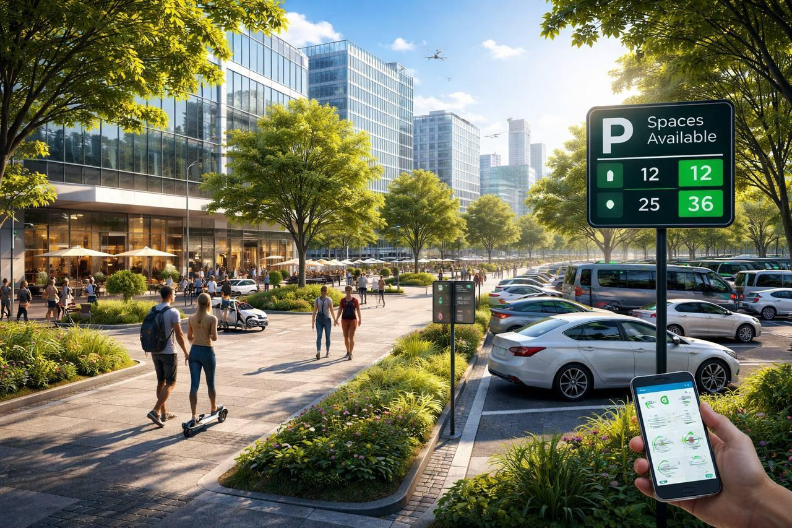
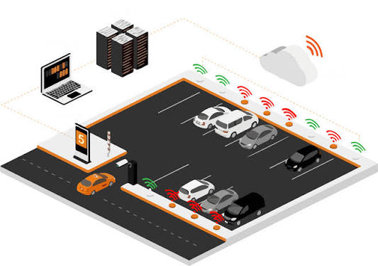
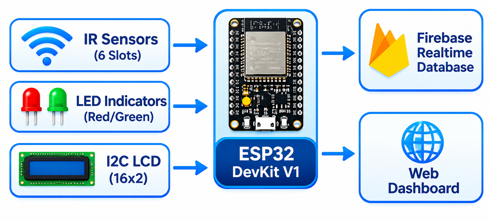
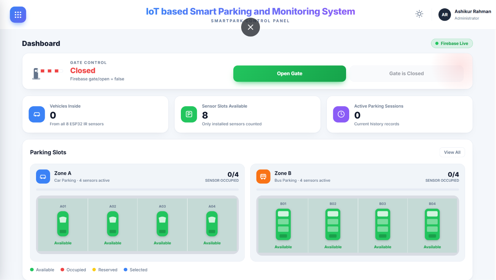
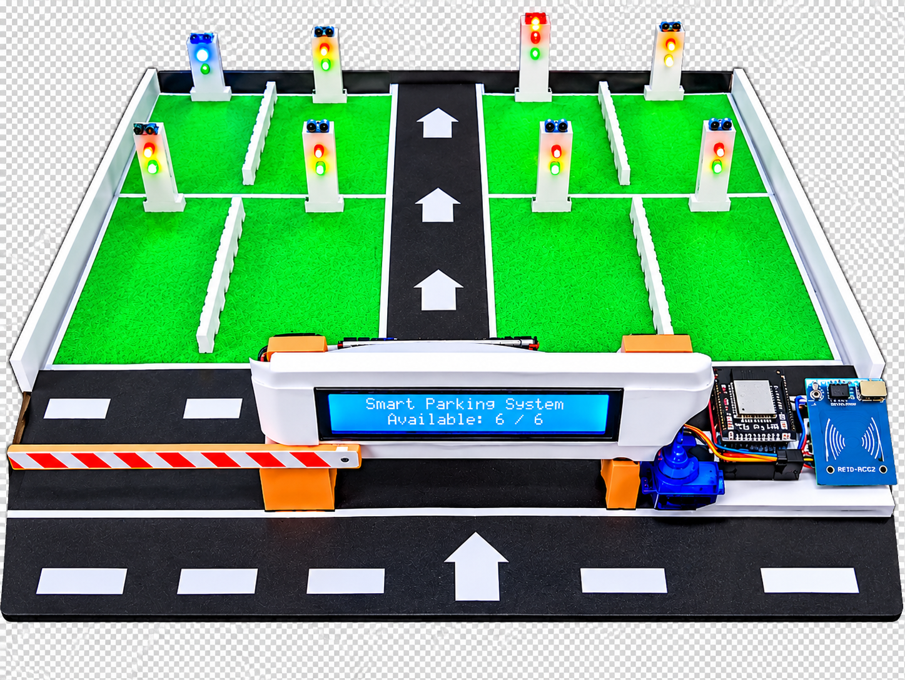

# 🚗 IoT Based Smart Parking and Monitoring System

<p align="center">
  
</p>

<p align="center">
  <b>A Smart IoT-Based Parking Management and Monitoring Solution</b>
</p>

<p align="center">
  
  
</p>

---

## 📌 Project Overview

The **IoT Based Smart Parking and Monitoring System** is an intelligent parking management solution designed to make traditional parking systems more efficient, convenient, and automated.

This project uses an ESP32 microcontroller, IR sensors, a servo motor, an LCD display, LEDs, and a buzzer to monitor parking activities.

Firebase Realtime Database is used for cloud-based data storage and synchronization, while a web dashboard provides parking status monitoring and remote gate control.

The main goal of this project is to reduce manual parking management, save time, and improve parking space utilization through Internet of Things (IoT) technology.

---
#project Report: Smart_Parking_Report (2).pdf

## 🎯 Project Objectives

- To detect vehicle presence using IR sensors.
- To monitor parking availability.
- To display parking information using an LCD.
- To indicate parking status through Red and Green LEDs.
- To control the parking entrance gate using a servo motor.
- To store and synchronize parking information using Firebase.
- To provide a web-based parking monitoring dashboard.
- To reduce manual effort in parking management.

---

## 🛠️ Technologies Used

### Hardware Components

| Component | Purpose |
|---|---|
| ESP32 | Main microcontroller |
| IR Sensor (2) | Vehicle detection |
| Servo Motor (1) | Automatic gate mechanism |
| 16×2 I2C LCD | Display information |
| Red LED | Occupied indication |
| Green LED | Available indication |
| 3-Pin Buzzer | Audio alert |
| Jumper Wires | Circuit connections |
| Power Supply | Power management |

### Software & Technologies

| Technology | Purpose |
|---|---|
| Arduino IDE | ESP32 programming |
| Embedded C/C++ | Microcontroller programming |
| HTML | Web page structure |
| CSS | Web page design |
| JavaScript | Dashboard functionality |
| Firebase Realtime Database | Cloud database |
| Wi-Fi | Internet connectivity |

---

## 🏗️ System Architecture

The system consists of five major stages:

1. **Detection:** IR sensors detect vehicle presence.
2. **Processing:** ESP32 receives and processes sensor signals.
3. **Indication:** LCD, LEDs, and buzzer provide local feedback.
4. **Cloud Communication:** ESP32 communicates with Firebase through Wi-Fi.
5. **Web Monitoring:** The web dashboard displays parking information and allows gate control.

### System Block Diagram

<p align="center">
  
</p>

---

## ⚙️ Working Principle

The system operates through the following process:

1. IR sensors detect the presence of a vehicle in the monitored parking zones.
2. The ESP32 receives sensor signals and processes the information.
3. The LCD displays relevant parking information.
4. Red and Green LEDs indicate parking status.
5. The buzzer provides audio alerts when required.
6. ESP32 sends parking information to Firebase using Wi-Fi.
7. The web dashboard retrieves and displays updated information.
8. Users can control the parking gate using the Open Gate and Close Gate buttons.

---

## 🔌 Hardware Setup

<p align="center">
  
</p>

### Main Hardware Connections

| Component | ESP32 Pin |
|---|---|
| LCD SDA | GPIO 21 |
| LCD SCL | GPIO 22 |
| Servo Signal | GPIO 18 |
| Buzzer Control | GPIO 19 |
| IR Sensor A01 | Defined in firmware |
| IR Sensor B01 | Defined in firmware |

**Note:** The actual IR sensor and LED GPIO assignments should be checked in the firmware source code.

---

## 🖥️ Web Dashboard

The SmartPark web dashboard provides a user-friendly interface for monitoring and controlling the parking system.

### 1. Dashboard

<p align="center">
  
</p>

### 2. Gate Control

<p align="center">
  
</p>

### Dashboard Features

- Dashboard Overview
- Live Parking Monitoring
- Vehicle History
- Firebase Connection Status
- Open Gate / Close Gate
- Parking Slot Status
- Entry and Exit Information (when recorded)
- Parking Duration (when entry and exit timestamps are available)

---

## 🅿️ Parking Zone Configuration

The proposed parking layout contains two zones:

| Zone | Vehicle Type | Total Slots | Parking Fee |
|---|---|---:|---:|
| Zone A | Car | 4 | ৳40 |
| Zone B | Bus | 2 | ৳100 |

**Prototype Note:** The current prototype uses two active IR sensors for monitoring. The remaining parking slots are static and can be automated by adding additional sensors.

The parking fees are configured values; payment processing is not currently integrated.

---

## 🔥 Firebase Database

Firebase Realtime Database is used to synchronize parking information between ESP32 and the web dashboard.

Example database structure:

```json
{
  "parking": {
    "zoneA": {
      "status": "occupied"
    },
    "zoneB": {
      "status": "available"
    }
  },
  "gate": {
    "status": "closed",
    "command": "close"
  }
}
```

*Note: This is an illustrative example. Actual database paths and field names depend on the firmware and JavaScript implementation.*

---

## 🚀 Installation and Setup

### Step 1: Clone the Repository

```bash
git clone https://github.com/Ashikur758/IoT-Based-Smart-Parking-System.git
```

### Step 2: Open Firmware

- Open Arduino IDE.
- Open `firmware/SmartPark_ESP32.ino`.
- Select the appropriate ESP32 board.
- Install the required libraries.
- Configure Wi-Fi and Firebase credentials.
- Select the correct COM port.
- Upload the code to ESP32.

### Step 3: Install Required Libraries

- ESP32 Board Package
- Firebase ESP Client by Mobizt
- ESP32Servo
- LiquidCrystal_I2C
- Wire

### Step 4: Configure Firebase

- Create a Firebase project.
- Enable Realtime Database.
- Configure the database URL.
- Set up authentication and database security rules.
- Add the required Firebase credentials to the firmware.
- Configure the web application with the appropriate Firebase settings.

### Step 5: Run the Web Dashboard

Open the web folder and configure the Firebase connection in `script.js`.

For a local development server, you can use VS Code Live Server or another suitable local web server.

---

## 📂 Project Structure

```text
IoT-Based-Smart-Parking-System/
│
├── images/          # Project images and screenshots
├── firmware/        # ESP32 source code
├── web/             # Web dashboard files
├── database/        # Firebase database structure
├── circuit/         # Circuit connection details
├── docs/            # Project report and presentation
│
├── README.md
├── LICENSE
└── .gitignore
```

---

## 🌟 Advantages

- Reduces manual parking management.
- Saves time and effort.
- Provides parking status monitoring.
- Supports remote gate control.
- Enables cloud-based data synchronization.
- Can be expanded with additional sensors.

---

## ⚠️ Limitations

- Only two IR sensors are active in the current prototype.
- Other parking slots are currently static.
- Remote monitoring requires an internet connection.
- Automatic number plate recognition is not implemented.
- Online payment is not integrated.
- Individual vehicle identification is not currently available.

---

## 🔮 Future Improvements

- Add sensors to every parking slot.
- Integrate RFID-based vehicle identification.
- Implement AI-based number plate recognition.
- Develop an Android application.
- Integrate online payment.
- Add parking reservation functionality.
- Implement SMS and email notifications.
- Improve system security and reliability.

---

## 👨‍💻 Project Information

**Project Title:** IoT Based Smart Parking and Monitoring System

**Project Type:** IoT / Embedded Systems / Web Development

**Controller:** ESP32

**Database:** Firebase Realtime Database

**Department:** Information and Communication Technology (ICT)

**University:** Mawlana Bhashani Science and Technology University (MBSTU)

---

## 👨‍🎓 Author

**Md. Ashikur Rahman Ashik**

Department of Information and Communication Technology (ICT)

Mawlana Bhashani Science and Technology University (MBSTU)

GitHub: [@Ashikur758](https://github.com/Ashikur758)

---

## 📜 License

This project is licensed under the MIT License.

---

<p align="center">
  <b>SmartPark – Making Parking Smarter with IoT Technology 🚗</b>
</p>

<p align="center">
  Thank you for visiting our project!
</p>
